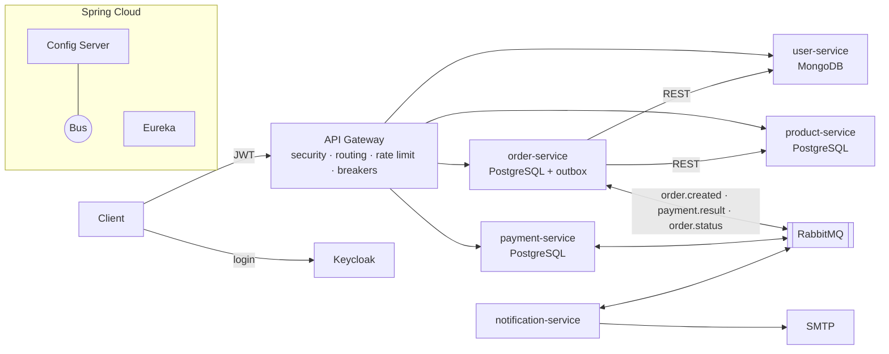

# E-Commerce Platform — Spring Boot Microservices

[](https://github.com/Ritiksharmaji/Spring-Boot-Microservices/actions/workflows/ci.yml)
[](https://github.com/Ritiksharmaji/Spring-Boot-Microservices/actions/workflows/codeql.yml)
  

A production-style e-commerce backend: **8 Spring Boot microservices** behind an API gateway,
**Keycloak** OAuth2 security, a **choreography saga with a transactional outbox over RabbitMQ**
for checkout, **Resilience4j**, full **observability**, **Testcontainers + end-to-end CI**, and a
**Docker / AWS Lightsail** deployment.



## Highlights

- **Checkout saga:** stock reserved atomically → order `PENDING` → payment → `CONFIRMED`, or `CANCELLED` with stock released; refunds on cancellation.
- **No lost events, no double charges:** transactional outbox, idempotent consumers, retries + dead-letter queues.
- **No overselling:** conditional `UPDATE … WHERE stock >= qty`, proven by a 30-thread PostgreSQL test.
- **Security:** Keycloak (PKCE), JWT validation and roles (`CUSTOMER`/`ADMIN`) at the gateway, identity headers set only from the token (impersonation blocked), CORS, rate limiting.
- **Resilience:** circuit breakers, retries with back-off (reads only), fallbacks; business errors never trip breakers.
- **Observability:** Prometheus + Grafana dashboard, Loki logs, Zipkin traces, all linked by trace id.
- **Quality:** 49 automated tests — unit, integration, Testcontainers (PostgreSQL, MongoDB, RabbitMQ) — plus a full-stack smoke test in CI.
- **Delivery:** one Dockerfile for all services, one-command Compose stack, images on GHCR, SSH deploy + rollback to AWS Lightsail with Nginx + Let's Encrypt.

## Services

| Service | Port | Responsibility | Data |
|---|---|---|---|
| `api-gateway` | 8080 | entry point: routing, JWT/roles, CORS, Redis rate limit, breakers, Swagger UI | Redis |
| `config-server` | 8888 | centralized configuration, Spring Cloud Bus refresh | — |
| `discovery-server` | 8761 | Eureka service registry | — |
| `user-service` | 8081 | profiles and addresses linked to Keycloak accounts | MongoDB `userdb` |
| `product-service` | 8082 | catalog, search, atomic stock reservation | PostgreSQL `productdb` |
| `order-service` | 8083 | cart, checkout, order lifecycle, saga, outbox | PostgreSQL `orderdb` |
| `notification-service` | 8084 | order emails from `order.status` events | — |
| `payment-service` | 8085 | idempotent charges, refunds | PostgreSQL `paymentdb` |

## Quick start

```bash
cd backend/microservices
docker compose up -d --build                    # ~3-5 min the first time
docker compose ps                               # wait until all are (healthy)
./scripts/smoke-test.sh                         # optional: full end-to-end check
```

| URL | |
|---|---|
| http://localhost:8080/swagger-ui.html | API docs (all services) |
| http://localhost:8483 | Keycloak — users `admin / Admin@123`, `customer / Customer@123` |
| http://localhost:8761 | Eureka |
| http://localhost:15672 | RabbitMQ (guest / guest) |
| http://localhost:9411 | Zipkin |
| http://localhost:8025 | Mailpit — order emails |
| http://localhost:3001 | Grafana (`docker compose --profile observability up -d`) |

Try it in 4 commands:

```bash
TOKEN=$(curl -s -X POST http://localhost:8483/realms/ecom-app/protocol/openid-connect/token \
  -d grant_type=password -d client_id=oauth2-ecom-pkce -d username=customer -d password='Customer@123' | jq -r .access_token)
curl -s http://localhost:8080/api/products | jq '.content'
curl -s -X PUT http://localhost:8080/api/users/me -H "Authorization: Bearer $TOKEN" -H 'Content-Type: application/json' \
  -d '{"firstName":"Riya","email":"customer@shop.local","address":{"street":"MG Road","city":"Pune","country":"India","zipcode":"411001"}}'
curl -s http://localhost:8080/api/orders -H "Authorization: Bearer $TOKEN" | jq
```

Full guided tour: **[docs/STEP-BY-STEP-FLOW.md](docs/STEP-BY-STEP-FLOW.md)** · Postman: **[postman/](postman)** ([guide](docs/POSTMAN.md)).

## Documentation

| | |
|---|---|
| [System design](docs/SYSTEM-DESIGN.md) | architecture, data, saga, resilience, scaling, trade-offs |
| [Application flow](docs/APPLICATION-FLOW.md) | sequence diagrams of every flow |
| [Step-by-step flow](docs/STEP-BY-STEP-FLOW.md) | run it and watch each step |
| [API reference](docs/API-REFERENCE.md) | endpoints, payloads, errors |
| [Events](docs/EVENTS.md) | RabbitMQ exchanges, queues, payloads |
| [Security](docs/SECURITY.md) | access matrix, threat model |
| [Observability](docs/OBSERVABILITY.md) | metrics, traces, logs, alerts |
| [Testing](docs/TESTING.md) | suites and how to run them |
| [Configuration](docs/CONFIGURATION.md) | config files, env vars, ports |
| [Local development](docs/LOCAL-DEVELOPMENT.md) | IDE setup and debugging |
| [Deployment](docs/DEPLOYMENT.md) | AWS Lightsail, CI/CD, backups, rollback |
| [Troubleshooting](docs/TROUBLESHOOTING.md) | common problems |
| [Architecture decisions](docs/ARCHITECTURE-DECISIONS.md) | why each choice was made |
| [Project journey](docs/PROJECT-JOURNEY.md) | from course branches to this platform |
| [Resume & interview](docs/RESUME-AND-INTERVIEW.md) | how to present the project |
| [Changelog](CHANGELOG.md) | what each branch-18 step delivered |

Each service folder also has its own README (endpoints, data, events, config, tests), e.g. [order-service](order-service/README.md).

## Tech stack

Java 21 · Spring Boot 3.5 · Spring Cloud 2025.0 (Gateway, Config, Netflix Eureka, LoadBalancer,
Stream, Bus, Circuit Breaker) · Spring Security OAuth2 Resource Server · Keycloak 26 ·
Spring Data JPA / MongoDB · PostgreSQL 16 · MongoDB 7 · RabbitMQ 3.13 · Redis 7 · Resilience4j ·
Micrometer · Prometheus · Grafana · Loki · Zipkin · springdoc-openapi · JUnit 5 · Mockito ·
Testcontainers · JaCoCo · Docker · Docker Compose · Nginx · Let's Encrypt · GitHub Actions · GHCR ·
CodeQL · Dependabot · AWS Lightsail

## Repository layout

```
backend/microservices/
├── pom.xml                     parent POM (versions for all modules)
├── Dockerfile                  one image recipe for every service (MODULE build arg)
├── docker-compose.yml          full local stack (+ observability profile)
├── .env.example                every environment variable with local defaults
├── config-server/  discovery-server/  api-gateway/
├── user-service/  product-service/  order-service/  payment-service/  notification-service/
├── docker/                     Postgres init, Keycloak realm, Prometheus, Loki, Grafana
├── deploy/                     production compose, Nginx, prod realm, server scripts
├── scripts/smoke-test.sh       end-to-end test of a running stack
├── postman/                    collection + environments
└── docs/                       all documentation
```

## Build & test

```bash
./mvnw clean verify     # all modules + tests (+ Testcontainers when Docker runs) + coverage
```
