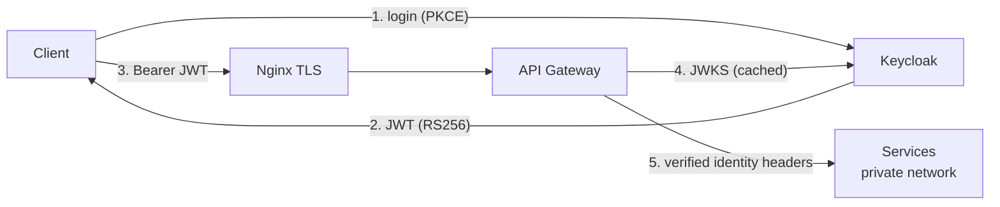

# Security

## Overview

| Layer | Control |
|---|---|
| Transport | TLS 1.2/1.3 at Nginx, HSTS, HTTP → HTTPS |
| Edge | Nginx per-IP rate limits; `/internal/**` and non-health actuator blocked |
| Authentication | Keycloak OIDC; Authorization Code + PKCE (public client `oauth2-ecom-pkce`); access tokens 15 min; brute-force protection; password policy (prod) |
| Token validation | gateway: signature via JWKS, `iss`, `exp`, `nbf` |
| Authorization | gateway path/method rules; deny-by-default; ADMIN re-checked inside services |
| Identity propagation | gateway strips client `X-User-*`, sets `X-User-ID` (`sub`), `X-User-Email`, `X-User-Roles` |
| Data access | ownership checks (`findByIdAndUserId`), 404 instead of 403 for others' orders |
| Input | Bean Validation on every request body, typed DTOs, JPA parameter binding (no SQL concatenation) |
| Secrets | environment variables / `.env` (git-ignored), `.env.example` templates only |
| Supply chain | CodeQL analysis, Dependabot, pinned base images, non-root containers |

## Roles and access matrix

| Endpoint | Anonymous | CUSTOMER | ADMIN |
|---|---|---|---|
| `GET /api/products/**` | ✅ | ✅ | ✅ |
| `POST/PUT/DELETE /api/products/**` | 401 | 403 | ✅ |
| `GET/PUT /api/users/me` | 401 | ✅ (own) | ✅ (own) |
| `/api/users`, `/api/users/{id}` | 401 | 403 | ✅ |
| `/api/cart/**` | 401 | ✅ (own) | ✅ (own) |
| `POST /api/orders`, `GET /api/orders[/{id}]`, `POST /api/orders/{id}/cancel` | 401 | ✅ (own) | ✅ (own) |
| `GET /api/orders/admin`, `PATCH /api/orders/{id}/status` | 401 | 403 | ✅ |
| `GET /api/payments/orders/{id}` | 401 | ✅ (own) | ✅ (own) |
| `GET /api/payments/admin` | 401 | 403 | ✅ |
| `/eureka/**`, gateway `/actuator/**` (except health/info) | 401 | 403 | ✅ |
| `/internal/**` | not routed | not routed | not routed |
| anything else | 403 | 403 | 403 |

Roles are read from `realm_access.roles` and from the client roles of `oauth2-ecom-pkce`.
New self-registered users receive `CUSTOMER` through the realm default role.

## Threats and mitigations

| Threat | Mitigation |
|---|---|
| Impersonation by sending `X-User-ID` | gateway removes client identity headers, sets them from the verified token (tested in `UserContextFilterTest`) |
| Privilege escalation via profile update | `role` ignored on `/api/users/me` (tested in `UserServiceTest`) |
| Reading other customers' orders/payments | queries always filter by the caller's id; same 404 as "not found" |
| Calling internal stock APIs directly | not routed by the gateway, blocked by Nginx, services not exposed |
| Token theft from browser apps | PKCE, short-lived access tokens, refresh tokens; no password grant in production |
| Brute force on login | Keycloak brute-force detection; Nginx `auth` rate limit |
| Abuse / scraping | Redis token bucket at the gateway (catalog), Nginx per-IP limit |
| IP spoofing to bypass rate limits | Nginx overwrites `X-Forwarded-For`; gateway trusts forwarded headers only behind Nginx |
| Leaked secrets | `.env*` git-ignored; history contained old CloudAMQP/Atlas credentials → **rotated** (see below) |
| Vulnerable dependencies | Dependabot weekly; CodeQL on PRs and weekly |
| Container breakout impact | non-root user in images, read-only config mounts, memory limits |

## Credentials that were committed in the learning branches

Early learning commits contained a CloudAMQP (RabbitMQ) password and a MongoDB Atlas password.
They were removed from the working tree in `branch-18-1`, but **remain in git history**.
Treat them as compromised: rotate them in the CloudAMQP and MongoDB Atlas consoles (the
production stack does not use those services). Optionally rewrite history with
`git filter-repo` — this changes every commit hash and requires a force push.

## Production checklist

See [DEPLOYMENT.md § Security checklist](DEPLOYMENT.md#12-security-checklist).
