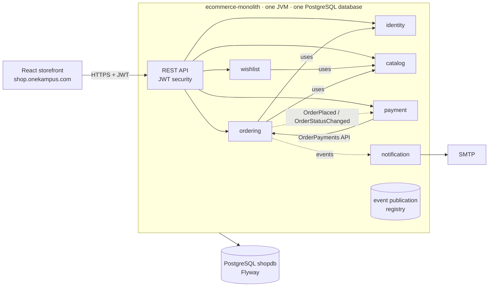

# E-Commerce Modular Monolith (Spring Modulith)

[](https://github.com/Ritiksharmaji/Spring-Boot-Microservices/actions/workflows/monolith.yml)
  

**Live:** API https://shop-api.onekampus.com ([Swagger UI](https://shop-api.onekampus.com/swagger-ui.html)) ·
React storefront https://shop.onekampus.com ([`../ecommerce-frontend`](../../frontend/web)).
Demo customer: `customer@shop.demo` / `Customer@123` (or register your own account).

The same e-commerce system as the [microservices platform](../microservices) — catalog, cart,
checkout with stock reservation, payments with refunds, order lifecycle, email notifications —
built as **one deployable Spring Boot application with enforced module boundaries**.
It runs in ~380 MB next to two other apps on a 2 GB server.



## Modules

| Module | Responsibility | Public API (what others may use) |
|---|---|---|
| `identity` | register / login (BCrypt + JWT), profile, **address book** (default address), admin user management | `CustomerDirectory`, `Customer` |
| `catalog` | products with images, sizes, sub-category, bestseller; search, soft delete, atomic stock reservation | `Catalog`, `ProductInfo`, `StockLine` |
| `ordering` | cart per product and size, checkout (address, card or cash on delivery, notes), order state machine | events `OrderPlaced`, `OrderStatusChanged`; `OrderPayments`, `OrderStatus`, `PaymentMethod` |
| `payment` | charges card orders after checkout, cash on delivery, refunds cancellations | — (listens to ordering events) |
| `wishlist` | products saved for later | — |
| `notification` | order emails (SMTP or log) | `NotificationSender` |
| `shared` | RFC 7807 errors, security, event-registry maintenance | open module |

Everything else lives in each module's `internal` package. **`ModularityTests` fails the build** if a
module touches another module's internals or if dependencies form a cycle.

## Highlights

- **One transaction for checkout:** stock reservation (`UPDATE … WHERE stock >= qty`), the order,
  clearing the cart and the `OrderPlaced` event commit together — no compensation needed if saving fails.
- **Reliable events without a broker:** Spring Modulith's JDBC event publication registry stores every
  event in the publishing transaction; listeners run after commit in their own transaction; failed
  deliveries are retried every minute (in-process equivalent of outbox + RabbitMQ + DLQ).
- **Same business rules as the microservices:** PENDING → CONFIRMED / CANCELLED, declined cards
  (> ₹50,000) cancel the order and return stock, customer cancel → refund, admin SHIPPED → DELIVERED,
  idempotent payment per order, ownership checks (404 for other customers' orders).
- **Storefront features:** sizes (stock shared across sizes), multiple images, address book with a
  default, wishlist, **cash on delivery** (confirmed immediately, paid on delivery), order payment status.
- **Security:** self-issued HS256 JWT (sub = user id, roles), BCrypt, login lockout after 5 failures,
  roles CUSTOMER / ADMIN, deny-by-default, CORS.
- **Schema by Flyway**, Hibernate in `validate` mode; demo data seeding behind `DEMO_MODE`.
- **Tests:** module boundaries, auth/security, catalog, the full asynchronous order journey, storefront
  features (sizes, address book, wishlist, cash on delivery, refunds) and a 20-buyers-for-5-units race on
  real PostgreSQL (Testcontainers, CI). Flyway upgrade V2 → V4 verified on a populated database.

## Run locally

Requires JDK 21 and a PostgreSQL database `shopdb`.

```bash
createdb shopdb                                    # local Postgres (or docker run postgres:16)
DB_USERNAME=$USER DB_PASSWORD= DEMO_MODE=true ADMIN_EMAIL=admin@local.test ADMIN_PASSWORD=Admin12345 \
  ./mvnw spring-boot:run
open http://localhost:8086/swagger-ui.html          # API docs
# storefront: cd ../ecommerce-frontend && npm ci && npm run dev  ->  http://localhost:5173
```

Or with Docker: `docker build -t ecommerce-monolith . && docker run -p 8086:8086 -e DB_HOST=host.docker.internal … ecommerce-monolith`.

## Test

```bash
./mvnw verify      # all tests (+ PostgreSQL Testcontainers when Docker runs) + JaCoCo + module diagrams
```
Module diagrams (PlantUML) are written to `target/spring-modulith-docs/`.

## API

Same paths as the microservices version, plus `/api/auth/*`. Full list: Swagger UI or
[docs/API.md](docs/API.md). Postman: [postman/](postman).

## Configuration

| Variable | Default | Purpose |
|---|---|---|
| `DB_HOST`, `DB_PORT`, `DB_NAME`, `DB_USERNAME`, `DB_PASSWORD`, `DB_POOL_SIZE` | `localhost`, `5432`, `shopdb`, `ecom`, `ecom`, `8` | PostgreSQL |
| `JWT_SECRET` | dev value | HS256 key, **≥ 32 characters, required in production** |
| `JWT_TTL`, `JWT_ISSUER` | `PT2H`, `ecommerce-monolith` | token lifetime / issuer |
| `ADMIN_EMAIL`, `ADMIN_PASSWORD` | empty | first admin, created at start-up |
| `DEMO_MODE` | `false` | load the 52-product clothing catalog + demo customer |
| `PAYMENT_MAX_AMOUNT` | `50000.00` | simulated card limit |
| `CORS_ALLOWED_ORIGINS` | localhost:3000, 5173 | browser origins |
| `MAIL_HOST`, `MAIL_PORT`, `MAIL_USERNAME`, `MAIL_PASSWORD`, `MAIL_FROM` | empty = log only | SMTP |
| `API_DOCS_ENABLED` | `true` | Swagger UI |
| `SERVER_PORT` | `8086` | HTTP port |

## Documentation

| | |
|---|---|
| [docs/ARCHITECTURE.md](docs/ARCHITECTURE.md) | modules, events, transactions, flows, security, data |
| [docs/MONOLITH-VS-MICROSERVICES.md](docs/MONOLITH-VS-MICROSERVICES.md) | the same system built two ways — what changed and why |
| [docs/API.md](docs/API.md) | endpoints and examples |
| [docs/DEPLOYMENT.md](docs/DEPLOYMENT.md) | live deployment on the shared Lightsail server |
