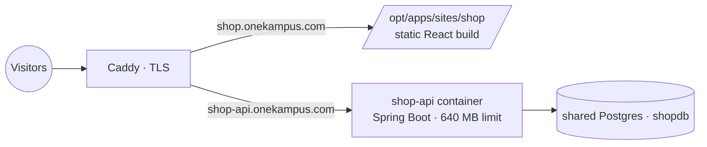

# Deployment

| What | Live URL | Source | Command |
|---|---|---|---|
| React storefront | https://shop.onekampus.com | [`frontend/web`](../frontend/web) | `./deploy/deploy.sh web` |
| Spring Boot API (modular monolith) | https://shop-api.onekampus.com | [`backend/monolith`](../backend/monolith) | `./deploy/deploy.sh api` |
| Both | | | `./deploy/deploy.sh all` |

Both run on the shared AWS Lightsail **apps-server** (`16.4.118.190`, 2 GB) next to Dabba and the
job portal, behind one Caddy (automatic HTTPS):

| Piece | Lives in |
|---|---|
| Storefront build + upload | [`frontend/web/deploy/deploy.sh`](../frontend/web/deploy/deploy.sh) (API URL from `frontend/web/.env.production`) |
| API build, upload, first-run DB + secrets | [`backend/monolith/deploy/deploy.sh`](../backend/monolith/deploy/deploy.sh) + `remote-setup.sh` |
| Server compose file + Caddyfile (all apps on the server) | `dabba-platform/deploy/` repository — synced by the API deploy |
| Secrets | `/opt/apps/.env` on the server only (`SHOP_*`) |

Requirements on your machine: JDK 21, Node 22, the SSH key `~/.ssh/apps-server-lightsail.pem`,
and the `dabba-platform` repository checked out next to this one.

Full guide (DNS, memory budget, rollback, backups, operations):
[backend/monolith/docs/DEPLOYMENT.md](../backend/monolith/docs/DEPLOYMENT.md).

**Not deployed:** [`backend/microservices`](../backend/microservices) (needs ~5–7 GB RAM) — it runs locally
with Docker Compose and in CI on every push; its production kit for a separate 8 GB server is in
[`backend/microservices/deploy`](../backend/microservices/deploy) and
[`backend/microservices/docs/DEPLOYMENT.md`](../backend/microservices/docs/DEPLOYMENT.md).
**Mobile** ([`frontend/mobile`](../frontend/mobile)) is released as Android APK/AAB builds (`cli/`: `npm run build:apk` / `build:aab`; `expo/`: EAS), not deployed to the server.
