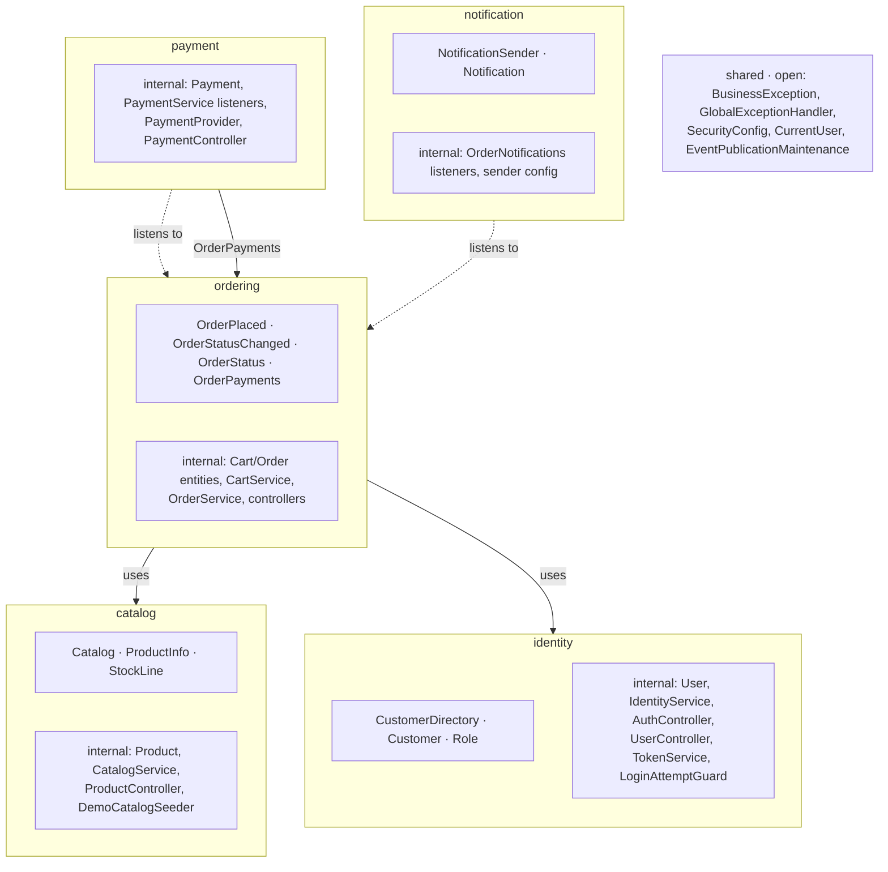
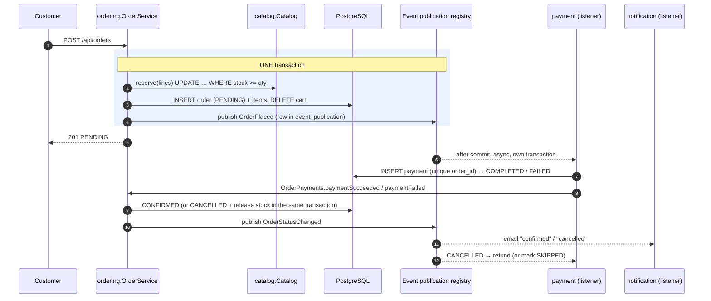
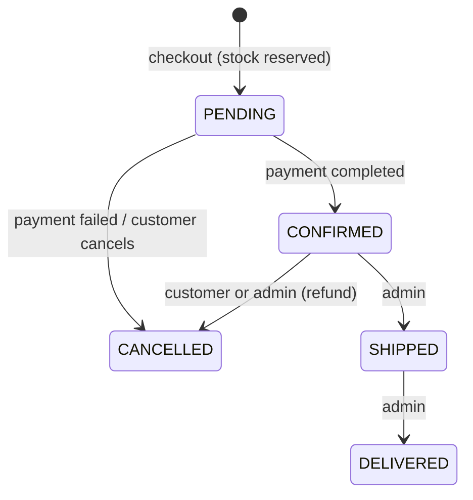
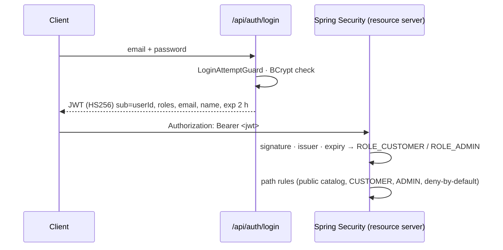

# Architecture — Modular Monolith

## 1. Module map

Rules (verified by `ModularityTests` with `ApplicationModules.verify()`):

- A module's **top-level package is its public API**; `internal` sub-packages are private.
- **No cycles.** Payment reports results through ordering's `OrderPayments` interface instead of
  publishing an event ordering would have to listen to (which would create ordering ↔ payment).
- `shared` is an *open* module (cross-cutting kernel) that every module may use.

## 2. Transactions and events

`@ApplicationModuleListener` = `@Async` + `@Transactional(REQUIRES_NEW)` +
`@TransactionalEventListener(AFTER_COMMIT)`. Every publication is stored in `event_publication`
when the event is published and marked completed when the listener succeeds.

| Concern | How it is handled |
|---|---|
| Event lost if the app crashes after commit | publication row exists → re-delivered on restart (`republish-outstanding-events-on-restart`) |
| Listener throws (e.g. DB hiccup) | publication stays incomplete → `EventPublicationMaintenance` re-delivers every minute |
| Duplicate delivery | payment: unique `order_id` (stored result re-reported, never charged twice); ordering: acts only while `PENDING` |
| Customer cancels before payment runs | payment records `SKIPPED`; a late `OrderPlaced` is not charged |
| Registry growth | completed publications purged after 7 days |

## 3. Order lifecycle

Every cancellation returns stock **in the same transaction** as the status change.

## 4. Security

| Endpoint group | Anonymous | CUSTOMER | ADMIN |
|---|---|---|---|
| storefront, Swagger, health, `GET /api/products/**`, `/api/auth/*` | ✅ | ✅ | ✅ |
| `/api/users/me`, `/api/cart/**`, `/api/orders`, own `/api/orders/{id}`, `/api/payments/orders/{id}` | 401 | ✅ own | ✅ own |
| product writes, `/api/users`, `/api/orders/admin`, `/api/orders/{id}/status`, `/api/payments/admin`, `/actuator/modulith` | 401 | 403 | ✅ |

Identity comes **only** from the verified token (`CurrentUser.id(jwt)`); there are no identity headers to spoof.

## 5. Data

One PostgreSQL database, schema owned by Flyway (`V1__identity_and_catalog.sql`,
`V2__ordering_and_payment.sql`) with foreign keys, unique and check constraints
(`stock_quantity >= 0`, cart quantity 1–100, one payment per order). Hibernate runs with
`ddl-auto: validate`, so a mismatch between entities and migrations fails start-up.

Modules still own their tables (`users`; `products`; `cart_items`, `orders`, `order_items`;
`payments`) and never query another module's tables — they call its public API. This keeps the
option to extract a module into a service later.

## 6. Runtime footprint

| Setting | Value | Why |
|---|---|---|
| Heap | `-Xmx256m` | demo traffic |
| Metaspace / code cache / direct memory | 160 MB / 48 MB / 32 MB caps | predictable native memory |
| JIT | C1 only (`TieredStopAtLevel=1`) | less memory, faster start-up |
| GC | Serial | smallest overhead for a small heap |
| Threads | virtual threads for requests | many concurrent requests, few platform threads |
| Measured | **~376 MB resident** after 30 orders + Swagger; start-up ~7 s | |
