# Application Flow

How every request and event moves through the platform, with sequence diagrams.
For the architecture and the reasons behind it see [SYSTEM-DESIGN.md](SYSTEM-DESIGN.md);
for a hands-on walkthrough with real commands see [STEP-BY-STEP-FLOW.md](STEP-BY-STEP-FLOW.md).

**Flows**
1. [Platform start-up](#1-platform-start-up)
2. [Life of a request through the gateway](#2-life-of-a-request-through-the-gateway)
3. [Login and tokens](#3-login-and-tokens)
4. [Browse the catalog (public)](#4-browse-the-catalog-public)
5. [Admin manages products](#5-admin-manages-products)
6. [Customer profile](#6-customer-profile)
7. [Cart](#7-cart)
8. [Checkout — happy path](#8-checkout--happy-path)
9. [Checkout — payment declined](#9-checkout--payment-declined)
10. [Checkout — out of stock / validation failures](#10-checkout--out-of-stock--validation-failures)
11. [Customer cancels → refund](#11-customer-cancels--refund)
12. [Admin fulfilment: ship and deliver](#12-admin-fulfilment-ship-and-deliver)
13. [Outbox publisher](#13-outbox-publisher)
14. [Configuration refresh (Spring Cloud Bus)](#14-configuration-refresh-spring-cloud-bus)
15. [A downstream service fails](#15-a-downstream-service-fails)

---

## 1. Platform start-up

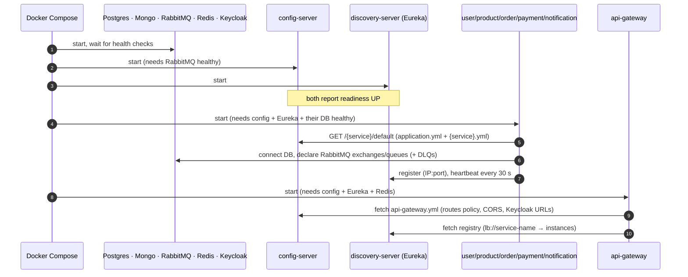

---

## 2. Life of a request through the gateway

Every `/api/**` call follows this path.

```mermaid
sequenceDiagram
    autonumber
    participant C as Client
    participant N as Nginx (prod)
    participant GW as API Gateway
    participant KC as Keycloak (JWKS)
    participant R as Redis
    participant Eu as Eureka cache
    participant S as Target service

    C->>N: HTTPS GET /api/orders  Authorization: Bearer <JWT>
    N->>GW: proxy, X-Forwarded-For = client IP (overwritten)
    GW->>GW: CORS (pre-flight answered here)
    GW->>KC: JWKS (first time only, then cached)
    GW->>GW: verify signature · iss · exp → roles from realm_access / client roles
    GW->>GW: authorize path+method (public / CUSTOMER / ADMIN / deny)
    alt not authenticated / not allowed
        GW-->>C: 401 / 403
    end
    GW->>GW: UserContextFilter: drop client X-User-*; set X-User-ID=sub, X-User-Email, X-User-Roles
    GW->>R: rate-limit token bucket (catalog route)
    GW->>Eu: resolve lb://order-service → instance
    GW->>S: forward (circuit breaker; traceparent header)
    S-->>GW: response (RFC 7807 problem+json on errors)
    GW-->>C: response
```

---

## 3. Login and tokens

**Browser / mobile app (production):** Authorization Code + PKCE.

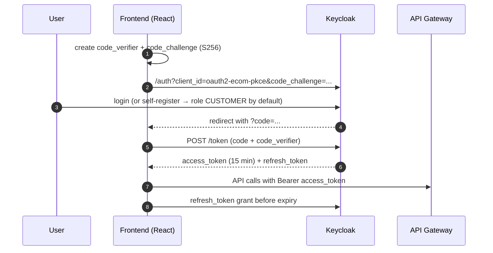

**Local testing / Postman:** password grant (enabled only in the local realm).

```bash
curl -s -X POST http://localhost:8483/realms/ecom-app/protocol/openid-connect/token \
  -d grant_type=password -d client_id=oauth2-ecom-pkce \
  -d username=customer -d password=Customer@123 | jq -r .access_token
```

The token's `iss` is always `http://localhost:8483/realms/ecom-app` (local) or
`https://AUTH_DOMAIN/realms/ecom-app` (production), because Keycloak runs with a fixed
`KC_HOSTNAME`, while the gateway downloads signing keys over the internal network.

---

## 4. Browse the catalog (public)

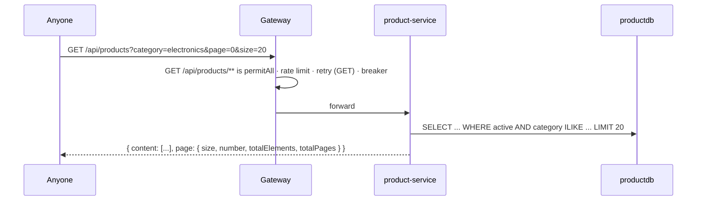

Also `GET /api/products/{id}` (404 if missing or soft-deleted) and
`GET /api/products/search?keyword=...` (name/description, in stock only).

---

## 5. Admin manages products

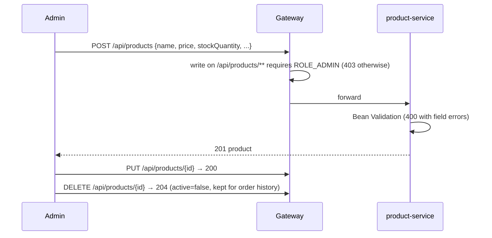

---

## 6. Customer profile

The Keycloak account (login) and the shop profile (address, phone) are separate; the profile is
linked to the account by the JWT `sub`.

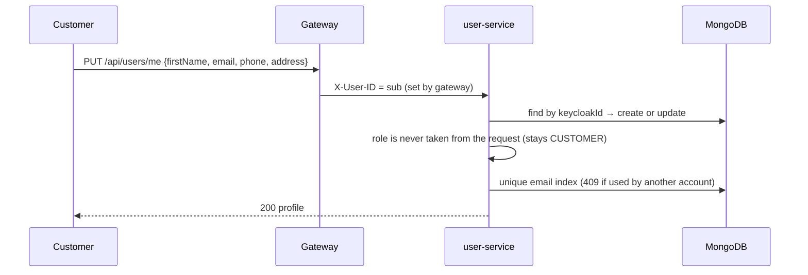

---

## 7. Cart

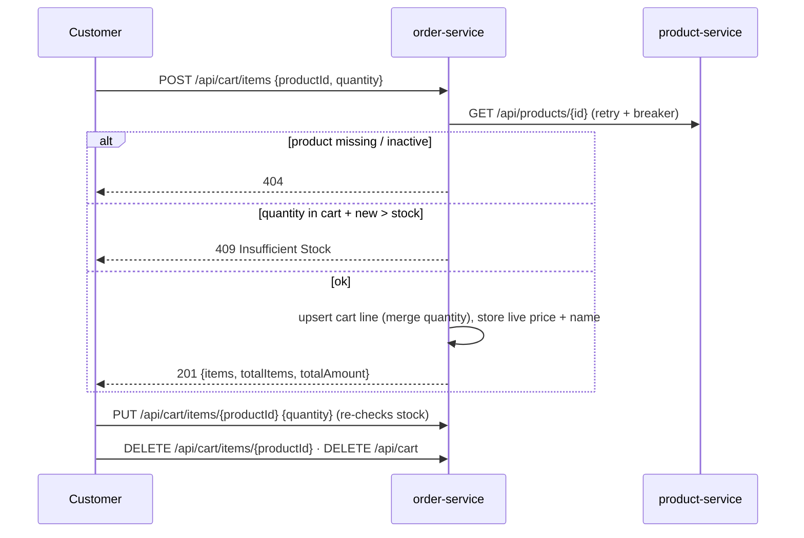

The cart shows prices at the time of adding; checkout always re-reads current prices.

---

## 8. Checkout — happy path

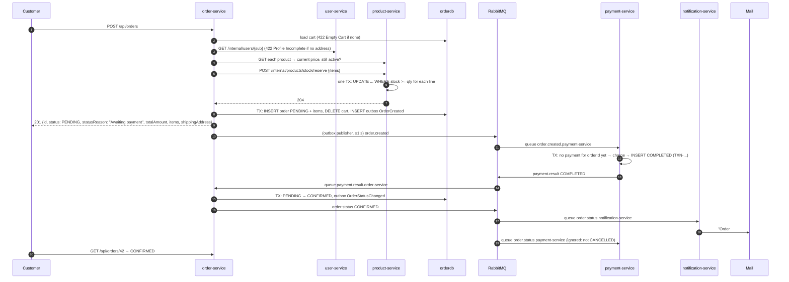

---

## 9. Checkout — payment declined

The simulated provider declines amounts above `PAYMENT_MAX_AMOUNT` (default 50 000.00).

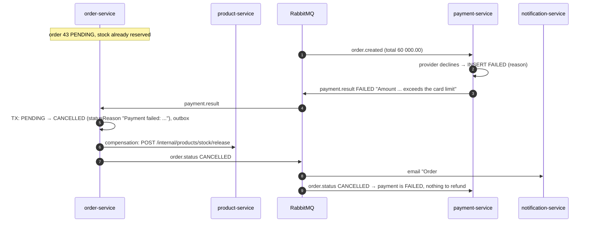

---

## 10. Checkout — out of stock / validation failures

| Situation | Response | Side effects |
|---|---|---|
| Cart empty | `422 Empty Cart` | none |
| No profile / no address | `422 Profile Incomplete` | none (stock untouched) |
| Product deleted since it was added | `422 Product Unavailable` | none |
| Stock taken by someone else meanwhile | `409 Insufficient Stock` | reservation rolled back in product-service; cart kept so the customer can adjust |
| product-service unreachable | `503 Service Unavailable` after 3 attempts (or immediately while the breaker is open) | none |
| DB failure after stock reserved | `500` | reservation **released** (compensation) |

---

## 11. Customer cancels → refund

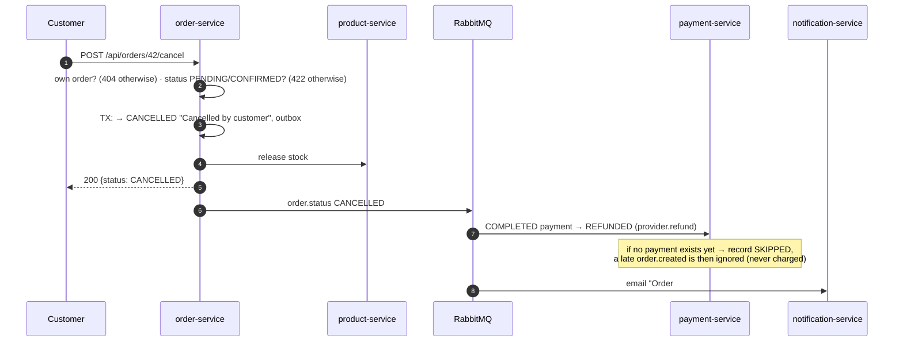

---

## 12. Admin fulfilment: ship and deliver

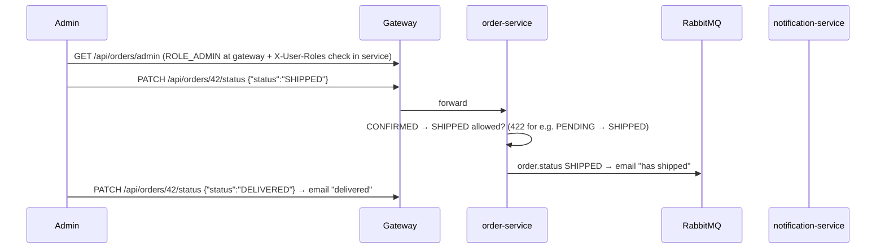

---

## 13. Outbox publisher

```mermaid
flowchart LR
    tx[Business TX<br/>order change + outbox row] --> table[(outbox_event<br/>published_at = null)]
    sched[@Scheduled every 1 s] --> read[read 50 oldest unpublished]
    read --> send{StreamBridge.send<br/>accepted?}
    send -- yes --> mark[published_at = now]
    send -- no / error --> keep[attempts++, last_error<br/>stop batch, retry next tick]
    mark --> purge[nightly purge > 7 days]
```

Ordering is preserved (oldest first, stop at the first failure). Delivery is at-least-once, which
is why every consumer is idempotent.

---

## 14. Configuration refresh (Spring Cloud Bus)

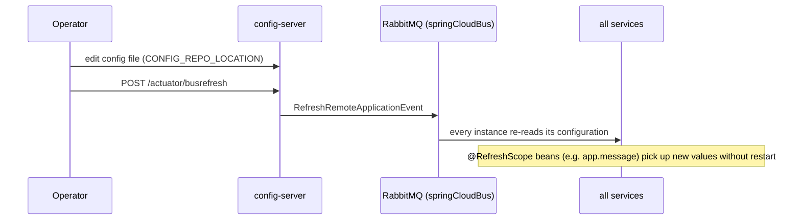

---

## 15. A downstream service fails

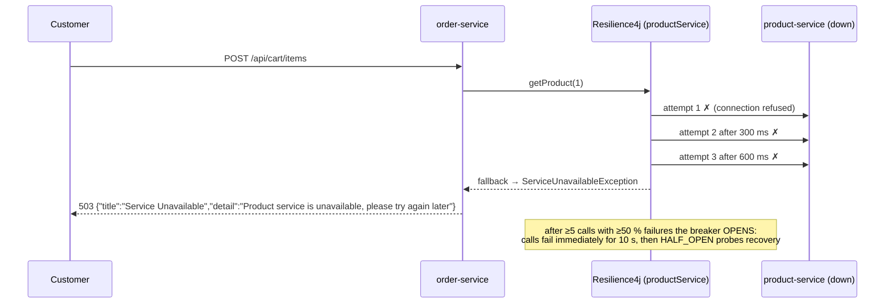
