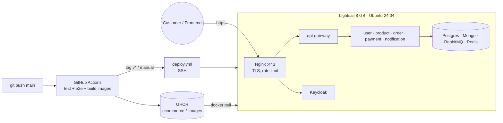

# Deployment — AWS Lightsail (single 8 GB instance)

This guide takes the platform from GitHub to a public HTTPS API on one AWS Lightsail server.
Everything runs in Docker; images are built by GitHub Actions and pulled from GitHub Container
Registry (GHCR), so the server never compiles code.



## 1. Sizing and cost

| Item | Choice | Why |
|---|---|---|
| Instance | Lightsail **8 GB RAM / 2 vCPU / 160 GB SSD** (Linux) | ~6.7 GB of container memory limits for the core stack, real usage ≈ 4–5 GB |
| OS | Ubuntu 24.04 LTS | Docker official packages, long support |
| Swap | 4 GB (created by `server-setup.sh`) | absorbs JVM start-up spikes |
| Static IP | 1 Lightsail static IP (free while attached) | DNS points to it |
| Price | ≈ USD 40–44 / month for the instance (check the Lightsail pricing page) | |

The existing 2 GB "apps-server" (Dabba, Job portal) is **too small**; use a separate instance.
For a cheaper demo, the 4 GB plan works if you skip the `observability` profile and keep only
one replica of everything (already the default).

## 2. Create the server (AWS console)

1. Lightsail → **Create instance** → Linux/Unix → **OS only → Ubuntu 24.04 LTS** → plan **8 GB**.
   Pick the region closest to your users (e.g. Mumbai `ap-south-1`).
2. Download / select an SSH key pair.
3. **Networking** tab → **Create static IP** → attach to the instance.
4. **Networking → IPv4 firewall**: keep **22**, add **80** and **443**. Remove anything else.
5. DNS (where your domain is managed) — two A records to the static IP, for example:
   - `shop-api.onekampus.com` → API (gateway)
   - `shop-auth.onekampus.com` → Keycloak (login)

## 3. Prepare the server

```bash
ssh -i <key>.pem ubuntu@<static-ip>
curl -fsSL https://raw.githubusercontent.com/Ritiksharmaji/Spring-Boot-Microservices/main/ecommerce-platform/deploy/scripts/server-setup.sh -o setup.sh
less setup.sh        # review
bash setup.sh        # Docker, swap, ufw firewall, fail2ban, key-only SSH, repo clone
exit                 # log in again so the docker group applies
```

## 4. Configure

```bash
cd ~/ecommerce/ecommerce-platform/deploy
cp .env.prod.example .env.prod && chmod 600 .env.prod
nano .env.prod
```

Fill in at least: `API_DOMAIN`, `AUTH_DOMAIN`, `FRONTEND_URL`, `CORS_ALLOWED_ORIGINS`,
`LETSENCRYPT_EMAIL`, every `*_PASSWORD` (`openssl rand -base64 24`), SMTP settings.

**Images:** GHCR packages are private by default. Either make the eight `ecommerce-*` packages
public (GitHub → your profile → Packages → package settings → Change visibility), or create a
classic personal access token with only `read:packages` and set `GHCR_TOKEN`.

## 5. TLS certificates

```bash
./scripts/init-letsencrypt.sh            # STAGING=1 ./scripts/init-letsencrypt.sh to test first
```

Gets one certificate for both domains and installs a twice-daily renewal cron job.

## 6. Start

```bash
./scripts/deploy.sh                          # core stack
PROFILES=observability ./scripts/deploy.sh   # + Prometheus, Loki, Grafana
```

`deploy.sh` pulls the images for `IMAGE_TAG`, starts everything with health-checked ordering
(`--wait`), prints the status and checks `https://API_DOMAIN/actuator/health`.

## 7. First admin user

The production realm has **no users** and the password grant is disabled (browser login with
PKCE only). Create the shop admin:

1. `https://AUTH_DOMAIN/admin` → log in with `KEYCLOAK_ADMIN` / `KEYCLOAK_ADMIN_PASSWORD`.
2. Realm **ecom-app** → Users → *Add user* (email verified) → Credentials → set password.
3. Role mapping → assign realm role **ADMIN** (customers who self-register get **CUSTOMER** automatically).
4. Optional hardening: Realm settings → Email (SMTP) and enable *Verify email*.

## 8. Verify

```bash
curl -s https://$API_DOMAIN/actuator/health          # {"status":"UP"}
curl -s https://$API_DOMAIN/api/products             # public catalog
```

Admin UIs are not exposed publicly. Open them through an SSH tunnel:

```bash
ssh -i <key>.pem -L 8761:localhost:8761 -L 15672:localhost:15672 \
    -L 9411:localhost:9411 -L 3001:localhost:3001 ubuntu@<static-ip>
# Eureka http://localhost:8761 · RabbitMQ http://localhost:15672
# Zipkin http://localhost:9411 · Grafana http://localhost:3001
```

## 9. Continuous deployment

`.github/workflows/deploy.yml` deploys over SSH when you push a tag `v*` or run it manually.
Set in GitHub → Settings:

| Kind | Name | Value |
|---|---|---|
| Secret | `LIGHTSAIL_HOST` | static IP |
| Secret | `LIGHTSAIL_USER` | `ubuntu` |
| Secret | `LIGHTSAIL_SSH_KEY` | private key (PEM) of a deploy key authorised on the server |
| Variable | `DEPLOY_ENABLED` | `true` |
| Variable | `API_DOMAIN` | e.g. `shop-api.onekampus.com` (post-deploy health check) |

Release flow: merge to `main` → CI tests, runs the end-to-end smoke test, publishes images
`:sha-xxxxxxx` and `:latest` → `git tag v1.0.0 && git push origin v1.0.0` → deployed.

**Rollback:** run the workflow manually with an older `image_tag` (e.g. `sha-1a2b3c4`), or on the
server `IMAGE_TAG=sha-1a2b3c4 ./scripts/deploy.sh`. Database schemas are only ever extended
(`ddl-auto: update`), so rolling back one version is safe.

## 10. Backups

```bash
crontab -e
30 2 * * * /home/ubuntu/ecommerce/ecommerce-platform/deploy/scripts/backup.sh >> /home/ubuntu/backup.log 2>&1
```

Dumps `productdb`, `orderdb`, `paymentdb`, `keycloakdb` (pg_dump) and `userdb` (mongodump),
keeps 7 days locally, uploads to S3 when `BACKUP_S3_BUCKET` is set. Also enable
**Lightsail automatic snapshots** (instance → Snapshots) for whole-disk recovery.
Restore: `./scripts/restore.sh ~/backups/<stamp>.tar.gz`.

## 11. Operations cheat-sheet

```bash
cd ~/ecommerce/ecommerce-platform/deploy
C="docker compose -f docker-compose.prod.yml --env-file .env.prod"
$C ps                                   # health of every container
$C logs -f --tail=200 order-service     # follow one service
docker stats --no-stream                # memory / CPU per container
$C restart payment-service              # restart one service
$C exec rabbitmq rabbitmqctl list_queues name messages consumers   # queues + DLQs
free -h; df -h                          # host memory / disk
```

| Symptom | Check |
|---|---|
| 502 from Nginx | `$C ps` – gateway healthy? `$C logs api-gateway` |
| 401 on every call | token `iss` must be `https://AUTH_DOMAIN/realms/ecom-app`; `KC_HOSTNAME` set? |
| Orders stuck in PENDING | payment-service logs; RabbitMQ queue `order.created.payment-service`; DLQs |
| Container restarts (OOM) | `docker inspect <c> --format '{{.State.OOMKilled}}'`; raise its `mem_limit` |
| Certificate expired | `cat ~/certbot-renew.log`; run the renew command from `crontab -l` |

## 12. Security checklist

- [x] Only 22/80/443 open (Lightsail firewall + ufw), SSH key-only, fail2ban
- [x] TLS 1.2/1.3, HSTS, security headers, HTTP→HTTPS redirect
- [x] Admin UIs bound to 127.0.0.1 (SSH tunnel only); `/internal/**` blocked at Nginx and gateway
- [x] Client IP taken from Nginx (not spoofable `X-Forwarded-For`) for rate limiting
- [x] Secrets only in `.env.prod` (mode 600, git-ignored); no test users or password grant in production
- [x] Swagger UI off in production (`API_DOCS_ENABLED=false`)
- [ ] Rotate any credential that was ever committed to git (see the repository README)
