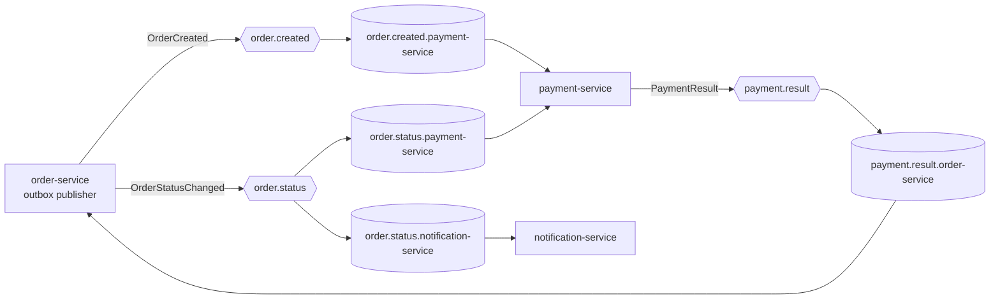

# Event Catalogue (RabbitMQ)

Asynchronous messages use **Spring Cloud Stream** with the **RabbitMQ binder**.
Each *destination* is a **topic exchange**; each consuming service has its own durable queue
named `<destination>.<group>`, so every service gets every event while replicas of the same
service compete for it.



| Exchange | Producer (binding) | Consumer group (binding) | Purpose |
|---|---|---|---|
| `order.created` | order-service `orderCreated-out-0` (via outbox) | `payment-service` (`orderCreated-in-0`) | charge the new order |
| `payment.result` | payment-service `paymentResult-out-0` | `order-service` (`paymentResult-in-0`) | confirm or cancel the order |
| `order.status` | order-service `orderStatus-out-0` (via outbox) | `notification-service`, `payment-service` (`orderStatus-in-0`) | email customer; refund on cancel |
| `springCloudBus` | config-server | every config client | configuration refresh broadcast |

## Reliability settings

| Setting | Value | Effect |
|---|---|---|
| `consumer.max-attempts` | 3 | in-process retries with back-off before giving up |
| `rabbit…consumer.auto-bind-dlq` + `republish-to-dlq` | true | failed messages go to `<queue>.dlq` with the exception in the headers |
| `producer.required-groups` | consumer group names | queues exist before the first consumer starts — nothing is dropped |
| Content type | `application/json` | records serialized by Jackson |
| Delivery | at-least-once | consumers are idempotent (see below) |

**Inspect / replay a dead letter:** RabbitMQ UI → Queues → `order.created.payment-service.dlq`
→ *Get messages*; to replay, use *Move messages* (shovel plugin) back to the original exchange
after fixing the cause.

## Payloads

### `order.created` — OrderCreatedEvent
```json
{
  "orderId": 42,
  "userId": "8d0c6f3e-...-keycloak-sub",
  "customerEmail": "customer@shop.local",
  "customerName": "Riya Customer",
  "totalAmount": 999.00,
  "items": [ { "productId": 1, "productName": "Mechanical Keyboard", "quantity": 2, "price": 499.50 } ],
  "createdAt": "2026-11-15T10:05:00"
}
```
Headers set by the outbox publisher: `eventType=OrderCreated`, `aggregateId=order-42`.

### `payment.result` — PaymentResultEvent
```json
{
  "orderId": 42, "userId": "8d0c6f3e-...", "paymentId": 3,
  "status": "COMPLETED",                 // or "FAILED"
  "amount": 999.00,
  "reason": null,                        // decline reason when FAILED
  "processedAt": "2026-11-15T10:05:01"
}
```

### `order.status` — OrderStatusChangedEvent
```json
{
  "orderId": 42, "userId": "8d0c6f3e-...",
  "customerEmail": "customer@shop.local", "customerName": "Riya Customer",
  "status": "CONFIRMED", "previousStatus": "PENDING",
  "totalAmount": 999.00, "reason": "Payment received",
  "occurredAt": "2026-11-15T10:05:01"
}
```
`status` ∈ `CONFIRMED`, `SHIPPED`, `DELIVERED`, `CANCELLED`.

## Idempotency rules

| Consumer | Duplicate / out-of-order handling |
|---|---|
| payment-service ← `order.created` | unique `orderId`; if a payment exists its stored result is re-published, no second charge; `SKIPPED` (cancelled first) → ignored |
| payment-service ← `order.status` | only `CANCELLED` matters; `COMPLETED → REFUNDED` once; otherwise records `SKIPPED` |
| order-service ← `payment.result` | applied only while the order is `PENDING`; later duplicates are logged and ignored |
| notification-service ← `order.status` | may send a duplicate email in the rare redelivery case (acceptable) |

## Evolving events

Add fields only (consumers ignore unknown properties — Jackson's default in Spring Boot);
never rename or remove a field in place. For a breaking change publish a new event type
(e.g. `order.created.v2`) and run both until all consumers moved.
