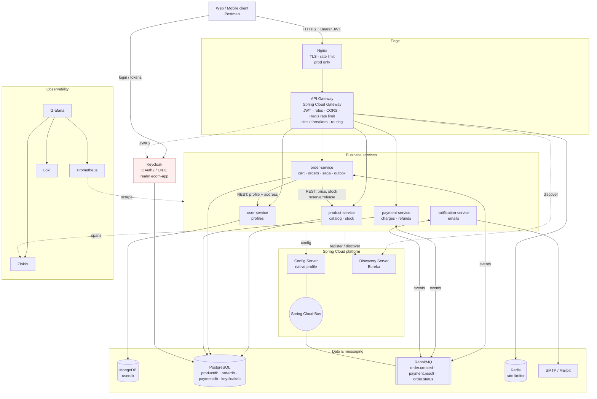
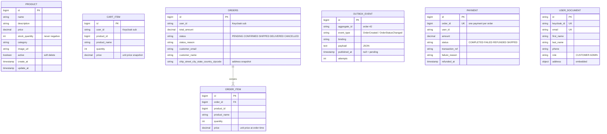
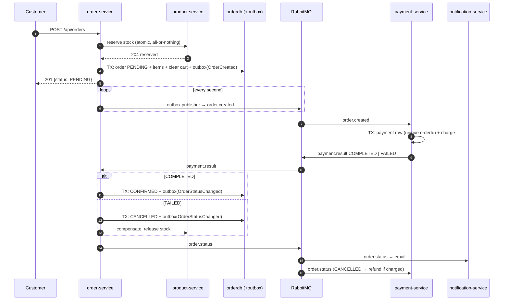
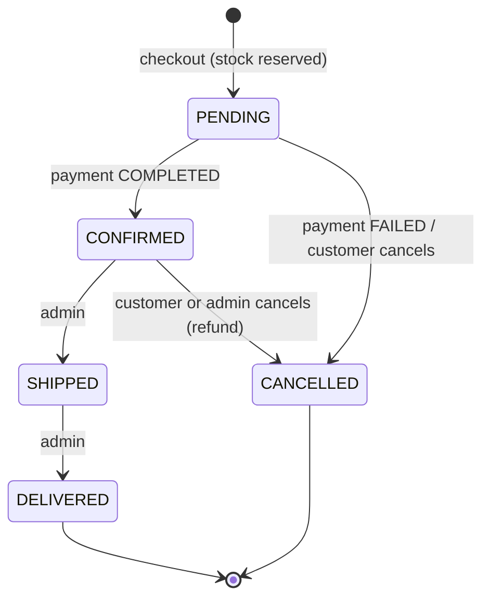
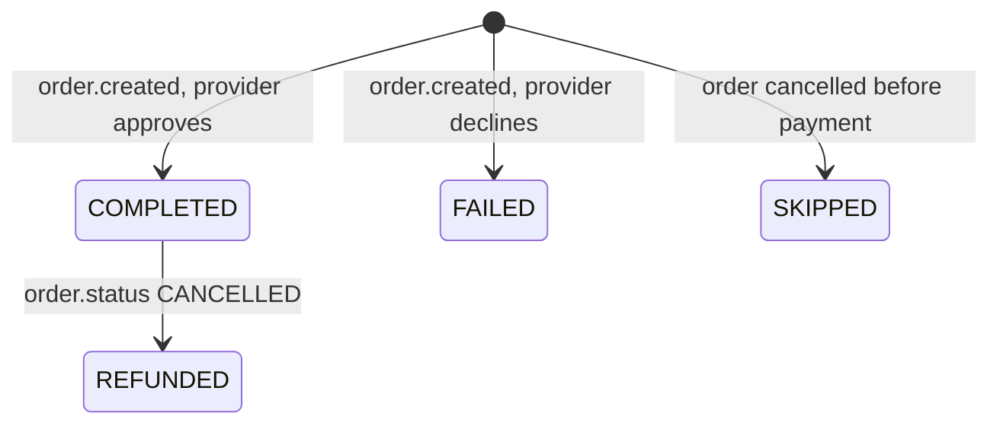

# System Design — E-Commerce Microservices Platform

> A production-style e-commerce backend: 8 Spring Boot services behind an API gateway,
> Keycloak for identity, a choreography saga over RabbitMQ for checkout, and a full
> observability stack. This document explains **what** the system does, **how** it is built
> and **why** each design choice was made.

**Contents**
1. [Requirements](#1-requirements)
2. [High-level architecture](#2-high-level-architecture)
3. [Services and responsibilities](#3-services-and-responsibilities)
4. [Data design](#4-data-design)
5. [Communication](#5-communication)
6. [Consistency: the checkout saga](#6-consistency-the-checkout-saga)
7. [Resilience and failure handling](#7-resilience-and-failure-handling)
8. [Security](#8-security)
9. [Observability](#9-observability)
10. [Scalability and capacity](#10-scalability-and-capacity)
11. [Deployment topology](#11-deployment-topology)
12. [Trade-offs and alternatives](#12-trade-offs-and-alternatives)
13. [Future improvements](#13-future-improvements)

---

## 1. Requirements

### Functional

| # | Requirement | Where |
|---|---|---|
| F1 | Anyone can browse, filter (category) and search products, paged | product-service |
| F2 | Admins create, update and (soft) delete products, manage stock | product-service |
| F3 | Users sign up / log in (OAuth2, Keycloak); customers keep a profile with a delivery address | Keycloak, user-service |
| F4 | Customers manage a cart with live prices and stock checks | order-service |
| F5 | Checkout reserves stock, charges the payment and confirms or cancels the order | order + product + payment |
| F6 | Customers see their order history, order details and payment status; can cancel before shipping (refund) | order, payment |
| F7 | Admins see all orders/payments and move orders CONFIRMED → SHIPPED → DELIVERED | order, payment |
| F8 | Customers get an email on every order status change | notification-service |

### Non-functional

| Quality | Target / approach |
|---|---|
| **Correctness** | Never oversell stock (atomic conditional update); never charge twice (idempotent payment); never lose an order event (transactional outbox) |
| **Availability** | One slow/down service must not take the others down: circuit breakers, retries, timeouts, fallbacks, async messaging |
| **Security** | Single public entry point; JWT validation; role-based access; identity cannot be spoofed; secrets outside git |
| **Scalability** | Stateless services (state in DBs/broker), horizontal scaling through Eureka + client-side load balancing |
| **Observability** | Metrics, distributed traces and centralized logs correlated by trace id |
| **Operability** | One-command local stack, health-checked startup, CI with end-to-end test, one-command deploy and rollback |
| **Cost** | Whole production stack on one 8 GB Lightsail instance (~USD 40/month) |

---

## 2. High-level architecture

**Request path:** client → (Nginx) → API gateway (authenticates the JWT, checks roles,
strips/sets identity headers, rate-limits, applies a circuit breaker) → service resolved through
Eureka (`lb://service-name`) → service database.

**Event path:** order-service writes events to its outbox table in the same transaction as the
business change → the outbox publisher sends them to RabbitMQ topic exchanges → consumers in
their own queues (one per consumer group) with retries and dead-letter queues.

---

## 3. Services and responsibilities

| Service | Port | Owns | Talks to | Key techniques |
|---|---|---|---|---|
| **config-server** | 8888 | configuration of every service | RabbitMQ (bus) | Spring Cloud Config (native, classpath), Bus refresh |
| **discovery-server** | 8761 | service registry | — | Netflix Eureka, self-preservation off for single node |
| **api-gateway** | 8080 | edge policies | all services, Keycloak (JWKS), Redis | Spring Cloud Gateway (WebFlux), OAuth2 resource server, Resilience4j, Redis rate limiter, CORS, Swagger aggregation |
| **user-service** | 8081 | users, addresses | MongoDB | profile bound to Keycloak `sub`, unique indexes, auditing |
| **product-service** | 8082 | products, stock | PostgreSQL `productdb` | atomic stock reservation, soft delete, paging/search |
| **order-service** | 8083 | carts, orders, outbox | product, user (REST), RabbitMQ, PostgreSQL `orderdb` | saga orchestration by events, transactional outbox, state machine, HTTP interface clients + Resilience4j |
| **notification-service** | 8084 | — (stateless) | RabbitMQ, SMTP | functional consumer, pluggable sender (email / log) |
| **payment-service** | 8085 | payments | RabbitMQ, PostgreSQL `paymentdb` | idempotent consumer, provider abstraction, refunds |

**Bounded contexts:** every service owns its data; no service reads another service's tables.
Cross-service data is obtained by API call (synchronous, when the answer is needed *now*) or by
event (asynchronous, when the caller does not need to wait).

---

## 4. Data design

### Database per service

| Database | Engine | Service | Why this engine |
|---|---|---|---|
| `productdb` | PostgreSQL | product | strong consistency for stock (row-level atomic updates) |
| `orderdb` | PostgreSQL | order | transactions spanning order + items + cart + outbox |
| `paymentdb` | PostgreSQL | payment | unique constraint per order = idempotency |
| `userdb` | MongoDB | user | document-shaped profile with embedded address, flexible schema |
| `keycloakdb` | PostgreSQL | Keycloak | identity data |

### Entities

**Snapshots on purpose:** an order copies product names, unit prices and the shipping address.
Later price changes, renamed products or a changed address must not rewrite history.

**Soft delete:** deleting a product sets `active=false`; old orders still reference it.

---

## 5. Communication

| From → To | Style | Why |
|---|---|---|
| Client → services | REST via gateway | single entry point, central security |
| order → product (`GET /api/products/{id}`) | sync REST | needs the live price **now** |
| order → product (`POST /internal/products/stock/reserve`) | sync REST | the customer must know immediately if stock is available |
| order → user (`GET /internal/users/{keycloakId}`) | sync REST | needs the address to place the order |
| order → payment (`order.created`) | async event | payment can be slow / retried; checkout returns immediately |
| payment → order (`payment.result`) | async event | completes the saga |
| order → notification, payment (`order.status`) | async event | fan-out to any number of consumers |
| config-server → all (`springCloudBus`) | async event | broadcast configuration refresh |

Synchronous clients are **declarative HTTP interfaces** (`@HttpExchange`) on a
`@LoadBalanced RestClient` (Eureka lookup, trace propagation), wrapped by Resilience4j.

Asynchronous messaging uses **Spring Cloud Stream** (functional `Consumer<T>` beans,
`StreamBridge` for output) with the **RabbitMQ binder**. Full catalogue: [EVENTS.md](EVENTS.md).

---

## 6. Consistency: the checkout saga

A single database transaction cannot span product, order and payment databases, so checkout
is a **choreography saga**: each service performs a local transaction and publishes an event;
failures trigger **compensating actions**.

### Guarantees and how they are achieved

| Risk | Mechanism |
|---|---|
| Two customers buy the last unit | `UPDATE product SET stock = stock - :q WHERE id = :id AND active AND stock >= :q` — returns 0 rows if short; all lines in one transaction (all-or-nothing). Verified by a 30-thread Testcontainers test on PostgreSQL. |
| Order saved but event lost (broker down, crash) | **Transactional outbox**: the event row commits with the order; a scheduled publisher retries until the broker accepts it, preserving order. |
| Event published for a rolled-back change | Impossible: the event exists only if the transaction committed. |
| Event delivered twice (at-least-once) | **Idempotent consumers**: payment has a unique `orderId` (re-publishes the stored result instead of charging again); order ignores payment results unless the order is still `PENDING`. |
| Order saved fails after stock reserved | Compensation: release stock in the `catch` block. |
| Payment declined | Compensation: order `CANCELLED`, stock released, customer emailed with the reason. |
| Customer cancels before payment is processed | Payment-service records `SKIPPED` for the order on `order.status CANCELLED`, so a late `order.created` is never charged. |
| Customer cancels after payment | `order.status CANCELLED` → payment-service refunds (`REFUNDED`). |
| Consumer keeps failing on a message | Binder retries (3 attempts) then routes it to a **dead-letter queue** (`<queue>.dlq`) for inspection/replay. |
| Messages sent before a consumer ever started | Producers declare `required-groups`, so durable consumer queues exist from the first publish. |

### Order state machine

Every transition goes through `OrderStatus.canTransitionTo(...)`; illegal ones return **422**.

### Payment state machine

---

## 7. Resilience and failure handling

| Layer | Mechanism | Configuration |
|---|---|---|
| Gateway → service | Circuit breaker per route + fallback (503 JSON) | 10-call window, 50 % failure rate, 10 s open |
| Gateway → product (GET) | Retry | 3 retries, GET only |
| Gateway | Redis token-bucket rate limit (per client IP) on the catalog | 10 req/s, burst 20 |
| Nginx (prod) | per-IP request limit | 30 r/s API, 10 r/s auth |
| order → product/user | Resilience4j circuit breaker **and** retry with exponential back-off | 3 attempts, 300 ms ×2; business errors (404/409) ignored |
| order → stock reserve | circuit breaker **only** — not retried (not idempotent) | |
| Messaging | consumer retries → DLQ; outbox retry; idempotent consumers | max-attempts 3 |
| Containers | health checks (readiness), ordered start-up, restart policy, memory limits, `ExitOnOutOfMemoryError` | |

**Failure scenarios**

| Scenario | Behaviour |
|---|---|
| product-service down | catalog: gateway fallback 503; cart/checkout: 3 retries then 503 "Product service is unavailable"; breaker opens after repeated failures and fails fast |
| payment-service down | checkout still succeeds (order PENDING); `order.created` waits in its durable queue; processed when payment-service is back |
| RabbitMQ down | checkout still succeeds; events wait in the outbox table and are published when the broker returns |
| notification-service / SMTP down | orders unaffected; messages retried then dead-lettered |
| Keycloak down | existing tokens keep working until expiry (gateway caches JWKS); new logins fail |
| Config server down after start | running services keep their configuration |
| Eureka down | clients use their cached registry |

---

## 8. Security

Full details: [SECURITY.md](SECURITY.md).

- **Authentication:** Keycloak (OIDC). Browser/mobile clients use Authorization Code + **PKCE**;
  the password grant is enabled only in the local realm for testing.
- **Authorization at the edge:** gateway validates JWT signature (JWKS), issuer and expiry, maps
  realm/client roles to `ROLE_*`, and applies path/method rules (public catalog, `CUSTOMER`,
  `ADMIN`, deny-by-default).
- **Identity propagation:** the gateway **removes** any `X-User-*` header from the client and sets
  `X-User-ID` (JWT `sub`), `X-User-Email`, `X-User-Roles`. Services trust only these.
- **Defence in depth:** admin endpoints re-check the role inside the service; ownership checks
  return 404 for other users' orders (no id probing); `/internal/**` APIs are not routed.
- **Transport & secrets:** TLS at Nginx, HSTS; credentials only in environment variables / `.env`
  files that are git-ignored.

---

## 9. Observability

Full details: [OBSERVABILITY.md](OBSERVABILITY.md).

| Signal | Tooling | Notes |
|---|---|---|
| Metrics | Micrometer → Prometheus → Grafana | every metric tagged `application=<service>`; dashboard "E-Commerce Overview" |
| Traces | Micrometer Tracing (Brave) → Zipkin | trace context propagated over HTTP and RabbitMQ |
| Logs | stdout → Promtail → Loki → Grafana | log lines contain `[traceId-spanId]`; Grafana links a trace id to Zipkin |
| Health | Actuator liveness/readiness | used by Docker health checks and Nginx |

---

## 10. Scalability and capacity

**Horizontal scaling:** all business services are stateless — cart, orders and payments live in
databases, sessions do not exist (JWT). Run more replicas and Eureka + Spring Cloud LoadBalancer
spread the calls. RabbitMQ consumer groups ensure each event is processed by **one** replica of a
service (competing consumers) while every *service* still receives it.

**What scales how:**

| Component | Scale strategy |
|---|---|
| gateway, services | more replicas (stateless) |
| outbox publisher | safe with one replica; with many, add `SELECT … FOR UPDATE SKIP LOCKED` (see improvements) |
| PostgreSQL | vertical first; read replicas for catalog reads; one DB per service already isolates load |
| Product reads | add a Redis cache for the catalog (hot read path) |
| RabbitMQ | quorum queues / cluster when needed |

**Back-of-the-envelope (single 8 GB node):** a Spring Boot service on 2 vCPU handles several
hundred simple requests/second; checkout makes ~5 internal calls + 2 DB transactions, so a
single node comfortably serves **tens of orders/second** — far beyond a small shop's peak.
The gateway rate limiter and Nginx limits protect the node from bursts.

---

## 11. Deployment topology

| Environment | How | Details |
|---|---|---|
| Local | `docker compose up -d --build` | 15 containers + optional observability profile; seeded Keycloak users |
| CI | GitHub Actions | unit + integration + Testcontainers, then the full stack and an end-to-end smoke test |
| Production | 1 × AWS Lightsail 8 GB, `deploy/docker-compose.prod.yml` | Nginx + Let's Encrypt, images from GHCR, SSH deploy workflow, nightly backups |

See [DEPLOYMENT.md](DEPLOYMENT.md).

---

## 12. Trade-offs and alternatives

| Decision | Chosen | Alternative | Why |
|---|---|---|---|
| Saga style | Choreography (events) | Orchestration (central coordinator, e.g. Temporal) | 3 participants, simple flow; no extra infrastructure |
| Broker | RabbitMQ | Kafka | already needed for Spring Cloud Bus; lower memory; per-message ack, DLQs built in. Kafka would win for event replay / very high throughput (the course branches 14–15 show the Kafka version) |
| Stock check | Sync reservation before the order exists | Async reservation as a saga step | customer gets an immediate "out of stock" answer; simpler compensation |
| Outbox publisher | Polling | CDC (Debezium) | no extra components; 1 s latency is fine |
| Identity | Keycloak | Spring Authorization Server / Cognito | full-featured, self-hosted, free |
| Gateway | Spring Cloud Gateway (reactive) | Nginx/Kong only | Java-native filters, Eureka integration, Resilience4j |
| User DB | MongoDB | PostgreSQL | demonstrates polyglot persistence; profile is document-shaped |
| Hosting | One VM + Compose | EKS / ECS | cost (~USD 40 vs 150+/month) at this scale; Compose files map 1:1 to ECS/Kubernetes later |

More in [ARCHITECTURE-DECISIONS.md](ARCHITECTURE-DECISIONS.md).

---

## 13. Future improvements

- Real payment provider (Razorpay/Stripe) behind the existing `PaymentProvider` interface, with webhooks
- Outbox `SKIP LOCKED` claiming for multiple order-service replicas; or Debezium CDC
- Catalog read cache (Redis) and product images on S3 + CloudFront
- Inventory reservation expiry (release stock of orders stuck in PENDING after N minutes)
- Database migrations with Flyway instead of `ddl-auto: update`
- Kubernetes manifests / Helm chart with HPA; managed RDS / Amazon MQ in a larger setup
- Contract tests (Spring Cloud Contract) between order-service and product/user services
- React storefront + admin panel (full-stack version of this project)
