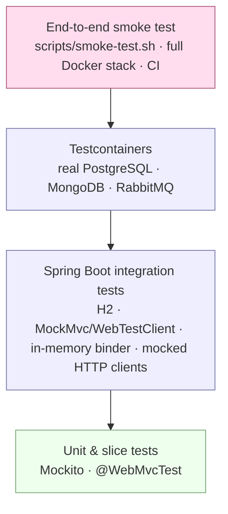

# Testing



## Run

```bash
cd ecommerce-platform
./mvnw verify                                   # all modules, all tests + JaCoCo reports
./mvnw -pl order-service test                   # one module
./mvnw -pl order-service test -Dtest=OrderFlowIntegrationTest#paymentFailed*   # one test
docker compose up -d --build && ./scripts/smoke-test.sh                        # end-to-end
```

Coverage report: `<module>/target/site/jacoco/index.html`.
Testcontainers tests are **skipped automatically when Docker is not available** and always run in CI.

Tests load the real service configuration from `config-server/src/main/resources/config/<service>.yml`
(via `spring.config.import` in `src/test/resources/application.yml`), so resilience, binding
and validation settings under test are the production ones.

## Test suites

| Module | Suite | Type | What it proves |
|---|---|---|---|
| api-gateway | `GatewaySecurityTest` | WebTestClient + mock JWT | 401 anonymous, 403 for customers on admin paths, deny-by-default for unknown/internal paths, public health |
| api-gateway | `GatewayCorsTest` | real port | pre-flight allowed for configured origins, rejected for others |
| api-gateway | `UserContextFilterTest` | unit | spoofed `X-User-*` removed; identity taken from the token |
| user-service | `UserServiceTest` | Mockito | role cannot be self-assigned; duplicate email rejected |
| user-service | `UserControllerTest` | `@WebMvcTest` | 401 without identity, 400 validation, 404 missing profile, saves for caller |
| user-service | `UserRepositoryMongoContainerTest` | Testcontainers MongoDB | unique email index, auditing timestamps |
| product-service | `ProductApiIntegrationTest` | H2 + MockMvc | typed CRUD, paging, category/search, 400/404, **all-or-nothing reservation**, release |
| product-service | `ProductStockConcurrencyContainerTest` | Testcontainers PostgreSQL | 30 parallel buyers, 10 units → exactly 10 succeed, stock 0 |
| order-service | `OrderFlowIntegrationTest` (15) | H2 + mocked clients | live prices & totals, stock/validation errors, checkout + outbox, price refresh, reservation not retried, profile/empty-cart rules, 503 after 3 retries, payment completed/failed (+ duplicates), outbox publish & broker-down, cancel → release once, isolation, admin state machine |
| order-service | `OrderPostgresContainerTest` | Testcontainers PostgreSQL | checkout → payment → outbox on the real database (numeric precision, JSON column) |
| payment-service | `PaymentSagaTest` (6) | in-memory binder | approve/decline, duplicate event charged once, refund, cancel-before-payment never charged, ownership |
| payment-service | `PaymentRabbitMqContainerTest` | Testcontainers RabbitMQ | `order.created` → `payment.result` through a real broker |
| notification-service | `OrderStatusNotificationTest` | in-memory binder | email content per status, nothing for PENDING / missing email |
| config/discovery | context tests | Spring Boot | servers start |
| whole system | `scripts/smoke-test.sh` | Docker Compose + curl/jq | login, roles, catalog, profile, cart, saga success/failure, refund, email, isolation |

## Bugs the tests caught during development

| Bug | Found by |
|---|---|
| Outbox payload mapped as PostgreSQL large object (`@Lob`) | writing `OrderPostgresContainerTest` |
| `@EnableMongoAuditing` on the main class broke web-slice tests | `UserControllerTest` |
| Auditing not active in `@DataMongoTest` slices | CI (Testcontainers) |
| Polling a RabbitMQ queue before the binder declared it | CI (Testcontainers) |
| CORS pre-flight needs Spring Cloud Gateway `globalcors`, not Spring Security CORS | `GatewayCorsTest` |
